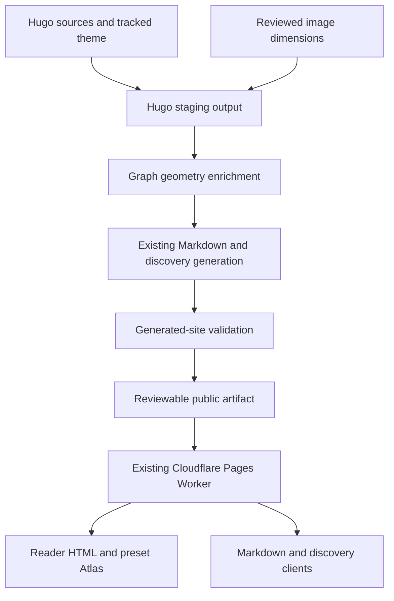
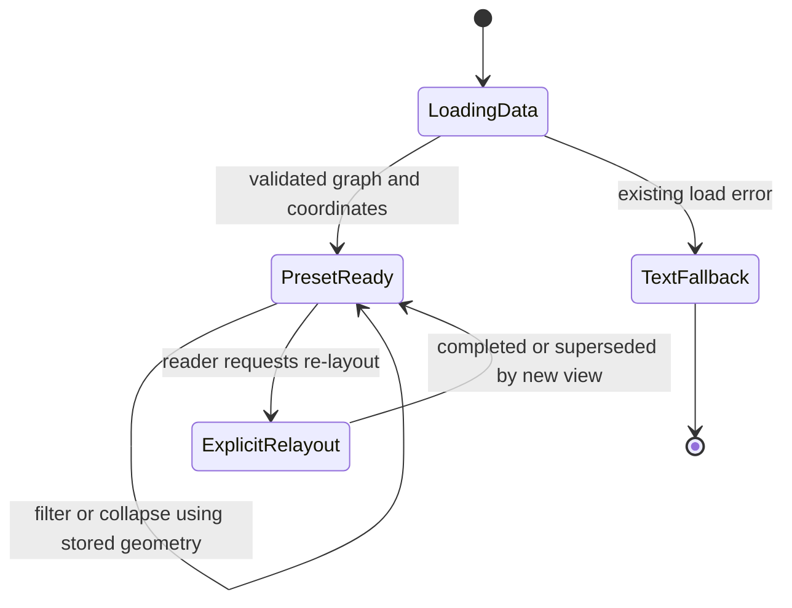
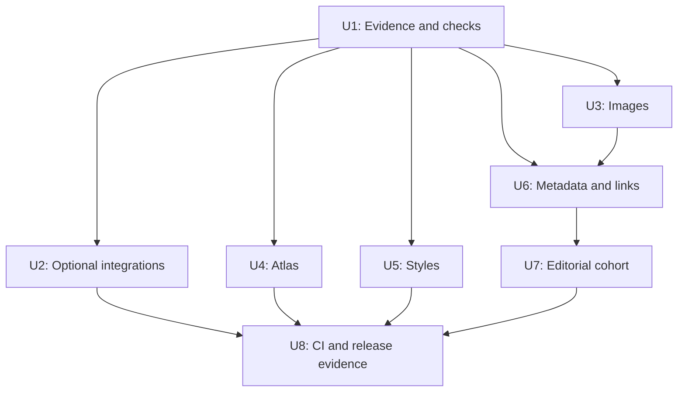

# Search Visibility and Lighthouse Quality - Plan

## Goal Capsule

- **Objective:** Readers can find, understand, and navigate Mohibul's technical writing quickly and accessibly, with measured improvements in search readiness and page experience.
- **Means:** Improve the existing Hugo/PaperMod site through the decisions in KTD2-KTD7.
- **Authority:** The Product Contract governs behavior. Key Technical Decisions govern mechanisms within it. Units and acceptance examples cannot override either contract.
- **Execution profile:** Characterize existing output before behavioral changes; prove improvements against the built site and real browser interactions.
- **Ownership:** An implementing agent or developer completes U1-U8 and supplies reviewable evidence. Production publication requires subsequent implementation/deployment authority.
- **Stop conditions:** Stop for a product-scope conflict, an unexpected public URL change, a threatened unrelated local edit, or an unavailable prerequisite that prevents meaningful verification. Report measured shortfalls rather than claiming an unachieved score.

---

## Product Contract

### Summary

Improve the audited performance, accessibility, metadata, and content-discovery problems while preserving the site's existing publishing and AI-reading interfaces.
Make optional advertising and tracking disabled by default.
Use repeatable measurements to pursue Lighthouse scores of 100 and evaluate search visibility through actual indexing and referral evidence.

### Problem Frame

The October 26, 2026 audit found different bottlenecks on different page types.
The Java Atlas had a mobile Performance score of 45, a 7.3-second Largest Contentful Paint, and 3,630 milliseconds of Total Blocking Time.
The sampled virtual-thread article scored 91 for Accessibility and 92 for SEO because of missing image alternatives and low-contrast code line numbers.
The generated-site inspection found 33 image occurrences without alt attributes among 85 image occurrences, no explicit dimensions on those images, and one distinct broken internal destination.

Homepage measurements varied materially: mobile Performance was 66, 94, and 99 across three runs.
The median was 94.
Tracking-blocked diagnostic runs all scored 99, while Best Practices consistently changed from 77 to 100.
Those diagnostic runs changed only the auditing browser's network requests.
They are evidence for prioritization, not deployed optimizations or proof of increased search rankings.

### Requirements

**Reader experience**

- R1. The Atlas must show its initial graph without running its current animated force-directed layout on the visitor's main thread.
- R2. Atlas search, topic/day/relation filters, collapse/expand, selection, article navigation, and explicit re-layout must remain usable.
- R3. Informative images must have accurate alternatives, decorative images must retain empty alt attributes, and rendered content images must reserve their intrinsic aspect ratio.
- R4. Code line numbers must meet a 4.5:1 contrast ratio in both themes, and each Atlas range control must have a distinct accessible name.
- R5. Page-specific styling must not be downloaded globally when that styling is unused.

**Tracking and search clarity**

- R6. Google Analytics, AdSense, and the Twitter advertising pixel must make no third-party requests in the default production configuration. Each integration may be enabled independently through an explicit owner-controlled configuration setting.
- R7. Page metadata and structured data must identify the author consistently and describe visible content accurately. Article images must represent the article, and modification dates must reflect real editorial changes.
- R8. Existing public URLs must remain stable, and the confirmed broken destination linked from `content/day100.md` must be corrected at its references.
- R9. Content improvements must strengthen direct explanations, verifiable evidence, and relevant internal links without inventing measurements, credentials, sources, or claims.

**Compatibility and proof**

- R10. Existing Markdown alternates, content negotiation, discovery documents, crawler choices, canonical relationships, exclusions, and error behavior must continue to work.
- R11. Published code examples and benchmark data must remain unchanged unless a separately justified content correction is explicitly reviewed.
- R12. Validation must inspect all eligible generated HTML pages and collect repeatable browser measurements on representative routes.
- R13. Verification must use the normal visitor experience. Do not detect Lighthouse, block tracking only for an auditor, hide content, or substitute a reduced page to manufacture scores.

### Key Decisions

- **Optional tracking over always-on tracking.** The user accepted the loss of some analytics collection or advertising revenue in exchange for the default-off approach. Governs R6. (session-settled: user-approved — chosen over globally enabled advertising/tracking after the analytics and revenue tradeoff was explained.)
- **Measured improvement over ranking promises.** The user confirmed a target of 100 without a guarantee of search rankings or AI citations. Governs R9, R12, R13. (session-settled: user-approved — chosen over promising search outcomes that the implementation cannot control.)

### Success Criteria

- SC1. Target 100 in Performance, Accessibility, Best Practices, and SEO on the representative routes in KTD8, using the same measurement protocol before and after changes.
- SC2. Treat Accessibility, Best Practices, and SEO below 100 on those routes as unresolved defects. A Performance shortfall must name the remaining bottleneck and actual scores; do not declare the 100-score target achieved unless measurements support it. Any acceptance below the target belongs to the user.
- SC3. Atlas initial-load LCP must be at most 2.5 seconds and TBT at most 200 milliseconds under KTD8's mobile protocol. These are measurable intermediate outcomes, not substitutes for SC1.
- SC4. Validation must report zero missing image alt attributes, zero unreserved content-image aspect ratios, and zero broken internal content destinations across the generated site.
- SC5. Search-indexing status and AI referrals/citations must be reported separately from Lighthouse. Lack of private Search Console access is a measurement limitation, not evidence of indexing success or failure.

### Acceptance Examples

- AE1. Covers R6. With all integrations unset or disabled, a normal browser loads any representative route without requests to the three integrations or their advertising descendants.
- AE2. Covers R6. Enabling only one integration emits that integration once while leaving the other two absent.
- AE3. Covers R3. An image with an intentionally empty description retains an empty alt attribute; an informative diagram exposes its reviewed description in HTML and Markdown.
- AE4. Covers R1, R2. A reader opens the Atlas, filters to a day range, selects a topic, collapses topics, and follows an article link without triggering an automatic CoSE layout.
- AE5. Covers R10, R11. After image descriptions, metadata, and styling change, the public route inventory and literal code examples remain valid, and the current Markdown endpoint content matches its built artifact.
- AE6. Covers R8. Every occurrence of the broken Day 100 link leads to the intended existing parallel-file-processing investigation, without renaming its published URL.

### Scope Boundaries

The plan covers the audited site-wide image and link issues, the sampled accessibility defects, graph initialization, unnecessary shared assets, accurate metadata, a bounded editorial pass, and reusable verification.

**Considered and not built**

- A new framework, theme migration, or broader homepage redesign: none is required to fix the measured defects.
- A visitor consent-management platform: R6 is implemented with default-off owner configuration; a consent platform would add a new product surface.
- New AI discovery protocols, synthetic FAQ schema, hidden text, manufactured mentions, or keyword stuffing: the research does not justify them.
- URL cleanup for the unusual existing article paths: changing established addresses creates migration work without resolving the measured failures.
- A web-worker layout engine: KTD4 moves the initial calculation out of the browser entirely; reconsider only if later measured interactions remain unacceptable.
- Full-article text duplication in newly expanded schema: recommended metadata does not require increasing page weight.

#### Deferred to Follow-Up Work

- A broader editorial refresh beyond U7's bounded cohort.
- Field Core Web Vitals and Search Console trend assessment after sufficient real traffic and indexing time.
- Modernizing the unrelated legacy Netlify/dev.to publishing workflow.
- A paid GEO monitoring platform or third-party analytics replacement.

---

## Planning Contract

### Grounding and Compatibility

The audited production deployment is commit `25355b32bb91175b708ecf9c074035b1673936bd`.
Its durable audit baseline is reproduced below.
Raw local evidence is in `.tools/geo-audit/audit-summary.json` and the accompanying Lighthouse reports; these ignored files are useful working evidence but must not be required in a fresh checkout.

| Route / profile | Performance | Accessibility | Best Practices | SEO | Evidence shape |
|---|---:|---:|---:|---:|---|
| Homepage / mobile | 94 | 100 | 77 | 100 | Median of 3 |
| Homepage / desktop | 100 | 100 | 77 | 100 | Single run |
| Day 99 article / mobile | 96 | 91 | 77 | 92 | Single run |
| Java Atlas / mobile | 45 | 95 | 77 | 100 | Single run |
| Homepage / mobile, tracking blocked | 99 | 100 | 100 | 100 | Diagnostic median of 3 |

The current checkout contains unrelated local theme, layout, search, resume, and draft work.
The tracked theme gitlink differs from the locally checked-out theme.
No implementation may silently include those changes in a release.

The existing build uses `scripts/ai/build.mjs` with staged output and safe publication.
Its locally bundled fallback is Hugo Extended 0.146.7.
The legacy deployment workflow currently names Hugo 0.166.0.
New quality validation must use an explicit reproducible Hugo version and the tracked theme rather than assume these environments are equivalent.

### Key Technical Decisions

- KTD1. **Start from the tracked deployment state.** Use the deployed commit, its tracked theme, and Hugo Extended 0.146.7 as the initial implementation and quality-workflow baseline, with a scoped checkout or reviewed file selection that preserves unrelated local changes. Do not copy the current working tree wholesale into deployment. Governs how R8, R10, and R11 are preserved.
- KTD2. **Gate integrations during HTML generation.** Keep existing identifiers in configuration, add independent explicit-enable settings, and guard the entire loader/initializer pair in the owning partials. Unset settings behave as disabled under R6. This is an owner configuration choice, not a visitor consent UI or a claim of consent compliance.
- KTD3. **Own image rendering in the project.** Add `layouts/_markup/render-image.html` rather than edit the theme submodule. Read descriptions from the Markdown occurrence, preserve existing resource/URL resolution and author attributes, and obtain dimensions from a checked-in source-to-dimensions map for current remote images. For local resources, use Hugo metadata where supported. SVG aspect ratios come from reviewed intrinsic dimensions or viewBox values. Production builds must not fetch remote images to discover dimensions. This implements R3 and follows the version-compatible fields documented by [Hugo image render hooks](https://gohugo.io/render-hooks/images/); do not depend on fields introduced after 0.146.7.
- KTD4. **Publish initial graph geometry with existing graph data.** Add a build-stage position pass after Hugo emits the graph JSON and before staged publication. Use Cytoscape 3.29.2, matching the current runtime version, as a pinned build dependency. Start from an ID-sorted deterministic grid, disable randomized initialization, and fix the reference bounds and layout options before exporting rounded coordinates in stable ID order. Compute the expanded graph once and provide deterministic topic-hub positions for collapse mode. Browser initialization and filtering use preset coordinates and fit the visible subset; explicit re-layout remains a deliberate reader action under R2. Nodes, edges, IDs, links, and eligibility remain authoritative in the existing Hugo graph output. The [Cytoscape preset layout](https://js.cytoscape.org/#layouts/preset) supports stored coordinates. A browser worker would retain a runtime computation lifecycle without helping first-load delivery.
- KTD5. **Keep shared CSS small without replacing the theme head.** Move support-only styles out of `css/extended` and include a fingerprinted support asset only for the support page, using a page parameter rather than a guessed layout name. Keep graph styling local to its existing layout. Retain only genuinely shared overrides globally. Prefer class-based Chroma output and correct line-number colors in a project-owned style asset, then verify both themes. Reuse Hugo's [asset bundling](https://gohugo.io/hugo-pipes/bundling/); avoid a full copied head template unless measured residual cost makes it necessary.
- KTD6. **Reuse real identity and image sources.** Give the existing Person entity a stable identifier, link author profiles to the existing about page, and select article images explicitly from genuine existing content. Preserve absent optional images instead of substituting the favicon as an article image. Keep published dates stable and update modification dates only for actual editorial changes. This implements R7 and adopts [Google's Article guidance](https://developers.google.com/search/docs/appearance/structured-data/article).
- KTD7. **Apply editorial judgment to a bounded cohort.** Review the two existing JMH articles in U7 plus the already sampled Day 99 investigation and capstone. Improve only specific explanation, sourcing, or navigation gaps found on those pages. This implements R9 using [Google's AI-search guidance](https://developers.google.com/search/docs/fundamentals/ai-optimization-guide), not a word-count formula. The [original GEO study](https://arxiv.org/abs/2311.09735) and [C-SEO Bench](https://arxiv.org/abs/2506.11097) justify treating algorithm-specific rewriting gains as uncertain.
- KTD8. **Pin a real-browser measurement protocol.** Use Lighthouse 13.5.0 and Node >=22.19, record the Chrome version and execution environment, and run browser audits sequentially in fresh profiles with ordinary network access and no request-blocking rules. Use the same Hugo version, tracked theme revision, browser version, mobile/desktop presets, cache posture, and host for each before/after pair. Record the baseline and candidate artifacts separately, keeping each artifact fixed across its three repeat runs. Collect three runs per route/profile and report the median of each category plus the underlying runs. Representative routes are `/`, `/about/`, `/blog/`, `/support/`, `/java/100daysofjava/graph/`, and `/posts/posts/java/100daysofjava/day99/`; measure both mobile and desktop. Preview and production results remain separate. SC1-SC3 own the thresholds.
- KTD9. **Verify changed output rather than relax the old baseline.** The current AI verifier compares complete parsed HTML against `.tools/ai-baseline` and ignores only its original AI metadata additions. Characterize content, links, code, and rendering first. Review intended deltas from R1-R9 before advancing any reference HTML. Do not make tests pass by removing the baseline or broadly ignoring scripts, images, CSS, or main content. Keep existing AI protocol assertions and add targeted checks for this plan's new behavior.
- KTD10. **Use one read-only quality workflow.** Add a pull-request quality workflow separate from the legacy deployment/publishing workflow. It must build the tracked site, run correctness checks, and attach Lighthouse reports without Cloudflare credentials or publishing actions. Do not compare scores obtained on different CI/local machines as if they were paired measurements.

### High-Level Technical Design

The build/data flow has two new enrichments; neither introduces a request-time service.

The tracking mode combinations share one rule: an integration's entire emitted loader and initializer are present only when its own owner setting is enabled.

| Configuration | HTML / browser outcome |
|---|---|
| All settings missing | R6 default behavior |
| All settings false | R6 default behavior |
| Only Google Analytics enabled | Google Analytics loader and initializer once |
| Only AdSense enabled | AdSense loader once |
| Only Twitter pixel enabled | Twitter loader and initializer once |
| Multiple settings enabled | Union of the explicitly enabled integrations, without duplication |

The Atlas initialization lifecycle retains its current controls.

Dependency order: U1 establishes evidence, U2-U7 make the scoped changes, and U8 turns the resulting checks into release evidence and CI enforcement.

### System-Wide Impact and Risks

| Concern | Decision / mitigation |
|---|---|
| Analytics and advertising reduction | Accepted product tradeoff in R6; document how owners deliberately enable integrations |
| Public graph JSON consumers | Add coordinates without changing existing graph facts; existing Markdown graph rendering continues to read its established fields |
| Image metadata ownership | Keep dimensions reviewable, keyed to the exact source identity; report missing metadata with the source page instead of performing hidden network work |
| Filter-dependent graph topology | Store full expanded positions and deterministic topic-hub positions; filtered subsets retain positions rather than require precomputed combinations |
| Styling changes | Check both themes, mobile layout, code overflow, support controls, and Atlas controls |
| Source/HTML/Markdown parity | KTD9 protects code, claims, sources, and public eligibility across representations |
| Lighthouse variability | KTD8 requires paired repeat measurements; don't treat the initial 66 score as a stable baseline |
| Publishing mismatch | Inspect actual production HTML, fingerprinted assets, graph data, and deployment identity; the Markdown catalog build ID alone does not identify every HTML/CSS change |

### Implementation-Time Decisions

The exact graph reference bounds, coordinate rounding, and final CSS split are tuned during implementation against the checks below.
Those details do not reopen the KTD4 or KTD5 ownership boundaries.
If a new browser/library version is needed, preserve separate before/after measurement sets instead of silently changing KTD8 mid-comparison.

---

## Implementation Units

### U1. Establish portable evidence and regression checks

**Goal:** Make the audit repeatable from a clean checkout.

**Requirements:** R8, R10-R13; SC1-SC5.

**Dependencies:** None.

**Files:** Create `scripts/audit-site.mjs`, `scripts/audit-lighthouse.mjs`, `scripts/lighthouse.config.json`, and `tests/site-quality.test.mjs`; modify `package.json` and `package-lock.json`.

**Approach:**

1. Record the baseline table and exact deployed commit as historical evidence, then capture a fresh paired baseline during implementation.
2. Reuse parse5 and the generated route/catalog inventory to inspect real HTML, local link targets, image attributes, and structured data. Compare URL paths against a case-sensitive POSIX artifact inventory independently of the host filesystem. Include generated public HTML outside the Markdown catalog when applicable.
3. Add the KTD8 runner and retain raw reports, settings, artifact identity, and summarized scores under ignored build artifacts.
4. Make new test files participate in the existing npm test entry point. Keep the new audit informative until U8 enables its release gates.

**Patterns to follow:** `scripts/ai/verify.mjs` for parsed artifacts and real HTTP checks; existing Node test/assert conventions.

**Execution note:** Add characterization coverage before modifying the templates and graph pipeline.

**Test scenarios:**

1. A known broken internal path and a case-only path mismatch are reported with their referring pages on both Windows and Linux; an existing redirect alias and a valid static asset are accepted.
2. A Markdown URL retains its HTML canonical relationship and noindex policy.
3. Report aggregation accepts three matching runs and computes the median, while refusing to combine different presets, browser versions, audit versions, or blocked-request diagnostics.
4. A failed or incomplete audit is reported as a failed measurement, not a score of zero or a successful run.

**Verification:** The existing defects are reproducibly identified without changing their output, and the historical diagnostic remains clearly separate from ordinary runs.

### U2. Make optional integrations default-off

**Goal:** Implement the accepted integration behavior.

**Requirements:** R6; AE1, AE2.

**Dependencies:** U1.

**Files:** Modify `config.yml`, `layouts/_partials/extend_head.html`, `layouts/_partials/extend_footer.html`, and `layouts/partials/twitter-analytics.html`; create `tests/site-tracking.test.mjs`; update `README.md`.

**Approach:**

1. Implement KTD2 with independent settings and preserve current identifiers for deliberate future use.
2. Cover both the external script and inline initializer for each integration.
3. Leave unrelated existing footer/focus work untouched unless it is part of the reviewed implementation base.

**Test scenarios:**

1. Covers AE1. A built default configuration contains no integration loader or initializer; a normal browser makes no descendant tracking/ad requests.
2. Covers AE2. Separate built configurations enabling one integration emit only that integration, once.
3. Explicit false values behave like unset settings.
4. Multiple enabled settings produce their union without duplicate initialization.

**Verification:** Default-on tracking is absent in the real visitor path, and source/config documentation makes each integration's behavior clear.

### U3. Repair image alternatives and reserved dimensions

**Goal:** Make all current content images accessible and stable during loading.

**Requirements:** R3, R10, R11; AE3, AE5.

**Dependencies:** U1.

**Files:** Create `layouts/_markup/render-image.html`, `data/image_dimensions.yml`, and `tests/site-images.test.mjs`; modify the affected published sources identified by U1 under `content/posts/` and any actual raw-HTML image sources; extend `scripts/audit-site.mjs`.

**Approach:**

1. Implement KTD3 and inventory the actual image occurrences rather than matching image-like text inside code.
2. Review informative images and write descriptions in their owning Markdown occurrences. Preserve intentional decorative descriptions.
3. Populate dimensions for the current remote sources from actual image metadata, including SVG aspect ratios.
4. Preserve supplied resource attributes and existing URL resolution. Keep below-fold lazy loading; do not force an above-fold LCP image to load lazily.
5. Use existing provider-supported sizing only where it reduces measured bytes without changing the diagram or its readability.

**Test scenarios:**

1. Covers AE3. Empty decorative text emits an empty alt attribute, while text containing quotes or markup is escaped correctly.
2. An informative image's reviewed description survives both HTML and Markdown generation.
3. A remote SVG and a local raster image render correct reserved ratios; author-supplied dimensions retain intended proportions.
4. Query-bearing URLs, fragments, page resources, global resources, and relative destinations resolve as before.
5. Missing or stale dimensions are reported with the source page and block the U8 gate without a build-time remote fetch.

**Verification:** All actual generated content-image occurrences meet R3, and code-fenced image examples remain literal.

### U4. Publish preset Atlas geometry and label its controls

**Goal:** Remove automatic initial force-layout work while preserving the Atlas experience.

**Requirements:** R1, R2, R4, R10; AE4, AE5.

**Dependencies:** U1.

**Files:** Create `scripts/graph-layout.mjs` and `tests/site-graph.test.mjs`; modify `scripts/ai/build.mjs`, `static/js/java-graph.js`, `layouts/knowledge-graph/single.html`, `package.json`, and `package-lock.json`.

**Approach:**

1. Add KTD4's geometry to the already staged graph JSON and provide it to the browser before initial rendering.
2. Preserve node IDs, relationship facts, article URLs, and the existing textual fallback.
3. Use preset positions for initial, filtered, and collapsed views. A missing expected position is a build validation failure, not a reason to start CoSE automatically.
4. Retain explicit re-layout and stop any superseded layout when replacing the current view.
5. Give the minimum and maximum day sliders distinct labels and associate their displayed values.

**Test scenarios:**

1. Identical graph input yields stable position mappings, and no graph facts or eligible node IDs change.
2. Covers AE4. Expanded, filtered, and collapsed initialization paths never invoke CoSE automatically.
3. Browser checks cover day-boundary values, no matching results, topic selection, relation toggles, collapse/expand, inspector selection, and article navigation.
4. Rapid filter changes during explicit re-layout leave the newest view active without an orphaned layout.
5. Keyboard and screen-reader checks distinguish the two day controls, and graph-load failure leaves the existing text fallback usable.
6. Generated Markdown relationship rows remain consistent with the unchanged graph facts.
7. Invalid or non-finite generated coordinates stop publication while the previous public artifact remains byte-identical; the geometry pass never introduces an automatic runtime-layout fallback.

**Verification:** The measured initial-load goals in SC3 are reached, and R2 is demonstrated in the browser rather than inferred from static JSON.

### U5. Scope styles and correct code contrast

**Goal:** Reduce unnecessary page assets and make code line numbers readable.

**Requirements:** R4, R5, R11.

**Dependencies:** U1.

**Files:** Move `assets/css/extended/support.css` to `assets/css/pages/support.css`; modify `content/support.md`, `layouts/_partials/extend_head.html`, and `config.yml`; create `assets/css/extended/code-accessibility.css` and `tests/site-styles.test.mjs`.

**Approach:**

1. Apply KTD5's page parameter and fingerprinted support bundle.
2. Use the theme's existing Chroma classes instead of repeated inline colors, then supply only the project overrides needed for R4.
3. Keep common article/site rules shared and verify route-specific assets before considering further CSS changes.

**Test scenarios:**

1. The support page loads its styles once; the homepage and ordinary articles do not request the support bundle.
2. Code line-number contrast passes R4 in light and dark themes.
3. Code text, indentation, copy behavior, and wide-code scrolling remain intact.
4. Support links, copy controls, QR interactions, and responsive layout retain their existing behavior.

**Verification:** The reduced asset set is visible in the browser's actual requests, with no support-page or code-reading regression.

### U6. Clarify metadata, author identity, and internal destinations

**Goal:** Correct the audited search-description and navigation defects.

**Requirements:** R7, R8, R10; AE6.

**Dependencies:** U1, U3.

**Files:** Modify `config.yml`, `layouts/_partials/templates/schema_json.html`, `content/about.md` only if needed to align existing identity, and `content/day100.md`; create `tests/site-metadata.test.mjs`.

**Approach:**

1. Apply KTD6 using the existing author, profile links, and about page.
2. Replace the generic homepage heading and description with accurate existing site positioning without copying the unrelated local redesign.
3. Keep BlogPosting, Person, WebSite, and breadcrumb relationships valid and consistent.
4. Correct every occurrence of the verified broken destination to the existing parallel-file-processing article, using Hugo-resolved references where appropriate.
5. Retain existing canonical URLs and leave optional article imagery absent when no representative visual exists.

**Test scenarios:**

1. The same author entity identifier appears across the homepage, about page, and articles.
2. An article with an explicit representative image emits its absolute URL; an article without one does not use a favicon as a substitute.
3. Rebuilding without an editorial change does not invent a new modification date.
4. Covers AE6. The repaired Day 100 references resolve to the intended existing canonical article.
5. Schema parses as JSON, reflects visible content, and does not add unsupported FAQ or review claims.

**Verification:** Generated metadata is internally consistent, the broken destination is gone, and route/canonical inventories are preserved.

### U7. Improve evidence and topic navigation in a bounded editorial pass

**Goal:** Make selected technical explanations easier for readers and retrieval systems to use.

**Requirements:** R9, R11.

**Dependencies:** U1, U6.

**Files:** Review `content/posts/day-69-unlocking-java-performance-secrets-harnessing-the-power-of-jmh-microbenchmarking.md`, `content/posts/day-70-diving-deep-into-array-copy-measuring-array-copy-performance-in-java-with-jmh-a-comparative-analysis-of-methods.md`, `content/posts/day99.md`, and `content/posts/day100-capstone.md`; create `docs/content-quality.md`; extend `tests/site-quality.test.mjs` only for objective link/code invariants.

**Approach:**

1. Apply KTD7 to concrete gaps: state the question and result clearly, identify benchmark environment/version where known, link primary sources, and keep experimental limitations visible.
2. Connect relevant explanations through the existing Java Atlas and accurate topic links.
3. Keep the author's voice and technical claims intact. Unknown provenance becomes an explicit editorial note for the owner rather than an invented fact.
4. Document a short publishing checklist tied to R7-R9.

**Test scenarios:**

1. All added or changed internal links resolve in the generated site.
2. Code examples, measured values, and result tables remain consistent with the pre-change sources under R11.
3. Human review confirms that each substantive claim has its existing evidence or an explicit limitation.
4. A page with no demonstrated editorial gap remains unchanged.

**Verification:** The bounded cohort has a reviewable editorial diff, with no formulaic padding or unsupported statistics added.

### U8. Enforce quality checks and prepare release evidence

**Goal:** Make regressions visible and provide an honest production acceptance record.

**Requirements:** R10-R13; SC1-SC5.

**Dependencies:** U2-U7.

**Files:** Create `.github/workflows/site-quality.yml`; modify `package.json`, `README.md`, `scripts/audit-site.mjs`, `scripts/audit-lighthouse.mjs`, and `scripts/ai/verify.mjs` only as required by KTD9; extend `tests/site-quality.test.mjs`.

**Approach:**

1. Turn the completed artifact checks into explicit failing gates and document their use before publication.
2. Add KTD10's independent workflow with pinned tool versions and retained audit artifacts.
3. Complete paired preview measurements under KTD8, inspect normal visitor behavior, and report every target shortfall.
4. After separately authorized production publication, verify the deployment identity, ordinary HTML, fingerprinted asset responses, graph JSON, Markdown content, and discovery files against the approved artifact.
5. Preserve a known-good previous Cloudflare deployment identity for rollback. Roll back a production regression rather than upload an unrelated working-tree build.

**Test scenarios:**

1. A broken link, missing image metadata, unlabeled range control, invalid schema, or forbidden default tracking request makes the relevant gate fail.
2. CI correctness checks run without access to deployment credentials and cannot publish to Cloudflare, Netlify, or dev.to.
3. Different browser/preset/artifact runs are not merged into one claimed improvement.
4. An unachieved SC1 target produces a shortfall record, not a successful 100-score claim.
5. A stale production page, stylesheet, or graph is detected even if the Markdown catalog build identity is unchanged.

**Verification:** All required contracts below have evidence from the normal built site, and authorized production verification is clearly distinguished from local/preview proof.

---

## Verification Contract

Validation belongs to implementation; no new tests, site builds, or Lighthouse runs were performed to create this plan.
Use the repo's existing npm, Node, Hugo, and PowerShell tooling.

| Check | Concrete entry point | Evidence / completion signal |
|---|---|---|
| Unit and artifact checks | `npm test`, expanded to include the new `tests/site-*.test.mjs` files | Existing AI tests and scoped new behavioral checks pass |
| Production-shaped build | `npm run build` | Staged publication succeeds with tracked sources, declared tool versions, and no unexpected routes |
| Existing AI contract | `npm run verify:ai` | Markdown, graph relationships, schema, crawler policy, source literals, and aggregate limits remain valid |
| Existing smoke checks | `tests/llm-seo-smoke.ps1` and `tests/support-page-smoke.ps1` | Both PowerShell checks pass against the reviewed built artifact |
| New site-wide audit | Proposed `npm run audit:site` | R3, R7, R8, and SC4 checked against real generated HTML, including applicable public pages outside the Markdown catalog |
| Browser functional checks | Proposed checks specified in U2-U6 | Desktop/mobile, both themes, normal tracking behavior, keyboard controls, graph interactions, support controls, and readable code |
| Paired Lighthouse audit | Proposed `npm run audit:lighthouse` | KTD8 report sets and SC1-SC3 results, with no diagnostic request blocking |
| Production checks after authorization | Existing live AI verifier plus U8's deployment/asset checks | The actual production deployment serves the approved HTML, assets, graph, Markdown, and discovery outputs |
| Search outcomes | Owner's Search Console and available referral/citation observations | SC5; no made-up indexing, ranking, or AI-visibility result |

There is no existing `release:validate` command or behavioral-skill evaluation suite to invoke.
Do not create an extra release framework solely to rename the checks above.
Use feature-first checks for changed behavior, then the existing full AI verifier and page-level browser checks.
Preserve real before/after screenshots for representative page types when reviewing intentional styling changes.

---

## Definition of Done

- Every R-ID has implementation and verification evidence through its owning units.
- SC1-SC5 are reported accurately, including any shortfall that still needs owner acceptance.
- The default artifact satisfies AE1, and enabled-integration fixtures satisfy AE2 without changing the measured default site.
- Public route/canonical inventories, exclusion policies, code examples, and benchmark facts are preserved under R8, R10, and R11.
- UI checks cover the full R2 Atlas flow and the affected support and article views.
- The diff contains no unrelated local drafts, theme update, redesign, or experiments.
- Abandoned approaches and temporary implementation helpers are removed from the proposed changes.
- The implementing agent supplies the exact artifact and commit identity plus reviewable reports; production deployment and production checks are reported only when actually authorized and completed.

